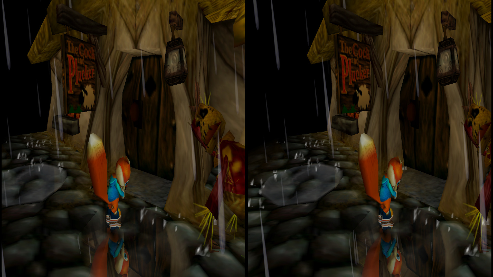
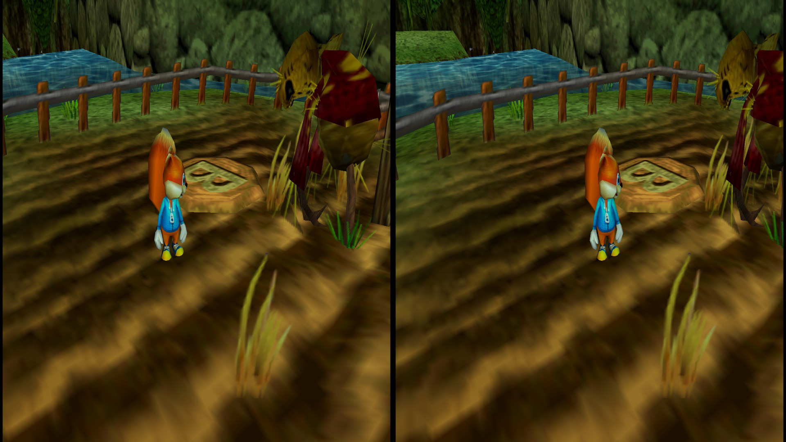
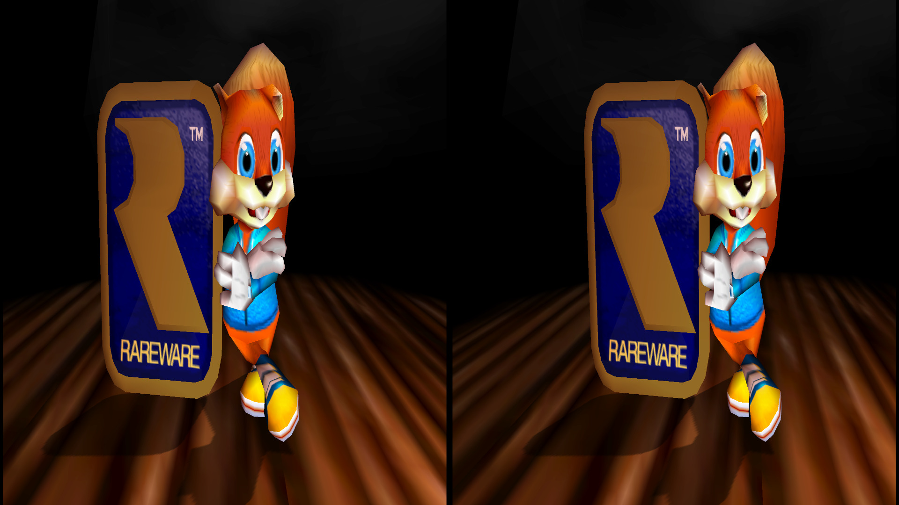

# Conker's Bad Fur Day 3D Stereo

**Conker's Bad Fur Day** (N64, 2001) playable on PC in stereoscopic 3D:
side-by-side, top-and-bottom, cross-view, interlaced (normal and reversed), and
Leia SR lenticular panels. It's a community build of sciaschi's native port,
[CBFD-Recompiled](https://github.com/sciaschi/CBFD-Recompiled), with a true
per-eye renderer: each eye gets its own camera, not a shifted copy of a flat
picture. The optional Leia SR loader ships in the zip; without the SR Platform
installed the mode falls back to side-by-side.



*Outside the Cock and Plucker. Full side by side, left eye on the left: view it
on a 3D display, in a VR viewer, or with the parallel free-viewing method. More
[below](#screenshots).*

> [!NOTE]
> **Unofficial fan project.** Not affiliated with or endorsed by Rare, Microsoft,
> Nintendo or Leia. No game data is included or distributed: you need your own
> US ROM of the game. See [3D credits](#3d-credits).

> [!IMPORTANT]
> **Made almost entirely with AI.** Nearly all of the 3D code, debugging and
> documentation in this build is written by an AI (Anthropic's Claude, through
> Claude Code), directed, tested and reviewed by a human, agrofubris. If you
> don't trust code written by AI, you can simply ignore this project. As with
> anything on the internet, you run it at your own discretion.

## Screenshots

Full side by side, left eye on the left. Captured at 15 % separation with Auto
Convergence on.




## Play in 3 steps (Windows)

1. **Download** the latest `conker-3d-stereo-*-win.zip` from
   [Releases](https://github.com/agrofubris/conker-3d-stereo/releases) and unzip
   it anywhere you can write to.
2. **Run `ConkerRecomp.exe`.** The first time, the launcher asks for your ROM:
   pick your own US `.z64` of Conker's Bad Fur Day. It's checked and remembered.
3. **Pick your display format** under Settings > Graphics > 3D Stereo, then
   **Start Game**.

If Windows says `VCRUNTIME140.dll` or `MSVCP140.dll` is missing, install
Microsoft's Visual C++ Redistributable (x64).

## Displays

| Display | 3D Stereo mode |
| --- | --- |
| Passive (polarised, row-interlaced) monitor | `Interlaced` or `Interlaced rev.`, whichever gives correct depth with your glasses |
| 3D TV / projector, side-by-side | `Side by side` |
| 3D TV / projector, top-and-bottom | `Top and bottom` |
| Leia SR glasses-free panel | `Leia SR (glasses-free)` |
| Cross-eye free viewing | `Cross-eye (X-view)` |

Side by side, top and bottom and cross-eye are the half formats: each eye is
rendered at the screen's shape and squeezed into its half, and the display
stretches it back. While a menu is open in those modes, the menu is shown flat
in both halves so it stays readable and clickable.

## Depth

Parallax follows 3D Vision: `parallax = Separation × (1 − Convergence / distance)`.

- **Stereo Separation** (0–40 %): how far apart distant objects are, as a
  percentage of the screen width. Most glasses-based displays look best under
  10 %; Leia SR panels want much more.
- **Stereo Convergence** (game units): the distance that sits on the screen
  plane. Nearer things pop out, farther ones recede.
- **Auto Convergence** (off by default): on each camera cut, sets the
  convergence once for the new shot so close-ups don't pop out too far. It never
  changes during a shot and never goes past your Stereo Convergence.
- **HUD Depth** (−100 to 100 %, 0 by default): lifts the HUD and the game's other
  2D overlays off the screen plane. Positive brings them out toward you; at 100 %
  they stand as far in front of the screen as the background is behind it.
  Fades and other full-screen effects stay on the screen.
- **3D Gamma** (1.00–2.00): brightens the picture for the light 3D glasses take
  away; around 1.20 to 1.30 suits most passive displays.

While playing, **Ctrl + arrows** adjust separation (left/right) and convergence
(up/down), **Ctrl + Page Up/Page Down** the HUD depth, and **Alt** instead of Ctrl
takes bigger steps.

The game's sparks, smoke and other screen-space sprites get the depth of what
they belong to, and shadows sit on the ground in both eyes. Anti-aliasing (MSAA)
turns itself off while a 3D mode is on.

## Leia SR

Set **Graphics API** to `D3D12` (Auto almost always picks it, but falls back to
Vulkan on a few GPUs, and the weave needs D3D12), and install Leia's SR
Platform. Without either, the mode presents a plain side-by-side picture
instead, with no missing-DLL popups.

**Not yet verified on an SR panel.** Reports are very welcome: start the game
with `leia_test.cmd` (next to the executable), which logs the run to
`leia-log.txt`, and attach that file. `leia_test.cmd noweave` shows the plain
side-by-side pair, to tell a weave problem apart from everything else.

## Known limits

- Each eye renders the whole frame, so 3D costs about twice the GPU time of 2D.
  If it stutters, lower the resolution first.
- 3D builds are Windows only for now. The code builds on Linux and macOS as the
  regular port does (Leia SR is Windows only), but those builds haven't been
  tried in 3D. On macOS, Auto Convergence keeps the slider's convergence.

**Tested** on an NVIDIA GeForce RTX 3080, on both D3D12 and Vulkan. **Not tested
yet:** AMD and Intel graphics cards, and a real Leia SR panel. Reports are very
welcome in the [issues](https://github.com/agrofubris/conker-3d-stereo/issues).

## 3D credits

- **sciaschi** and contributors — [CBFD-Recompiled](https://github.com/sciaschi/CBFD-Recompiled),
  the port this build is based on (see [Credits](#credits) below for everything
  it builds on).
- **oneup03** — [RT64 3D](https://github.com/oneup03/rt64-3D), whose stereo
  rendering and Leia SR implementation this follows, and testing and feedback.
- **bo3b** — [SR-lib](https://github.com/bo3b/SR-lib), the Simulated Reality
  wrapper used for the optional D3D12 weave.
- The Leia SR loader follows the Leia work of kandowontu2 and agrofubris in
  their other ports.

Licence: MIT, the same as the port (see [LICENSE](LICENSE)), covering the code
only: it grants no rights in the game or its data. Conker's Bad Fur Day is © Rare
Ltd.; this project is not affiliated with Rare, Microsoft, Nintendo or Leia.

---

## About the port

Everything below is the README of CBFD-Recompiled, the port this build is based
on. Links about building point to this repository, which builds the 3D version.

A native PC port of **Conker's Bad Fur Day** (N64, US version). It's built by
statically recompiling the game with [N64Recomp](https://github.com/N64Recomp/N64Recomp),
starting from the [Conker decompilation](https://github.com/mkst/conker). It runs on
[N64ModernRuntime](https://github.com/N64Recomp/N64ModernRuntime) and is rendered by
[RT64](https://github.com/rt64/rt64).

> **This repository contains no game data.** You need your own legally obtained
> copy of the US ROM. Everything from the game is extracted from that ROM on
> your machine during the build.

## Download

The 3D builds (Windows) are on [this repository's Releases page](https://github.com/agrofubris/conker-3d-stereo/releases).
Ready-to-play builds of the regular port for Windows, Linux and macOS (Apple
Silicon, macOS 15 or later) are on
[CBFD-Recompiled's Releases page](https://github.com/sciaschi/CBFD-Recompiled/releases).
Unpack one anywhere, run `ConkerRecomp`, and pick your US ROM in the launcher the
first time. The packages contain no game data: you still need your own ROM. The
macOS app isn't signed with an Apple developer ID, so the first time, open it and
then choose **Open Anyway** in System Settings > Privacy & Security. To build it
yourself instead, read on.

## Features

- Runs natively on Windows (Direct3D 12 or Vulkan), Linux (Vulkan) and macOS
  (Metal), rendered by RT64. Supports higher resolutions, widescreen,
  stereoscopic 3D (side by side, cross-eye, top and bottom, interlaced, and
  Leia SR panels on Windows with Direct3D 12) with automatic convergence,
  anti-aliasing and high frame-rate presentation.
- Game controllers and keyboard, with remappable controls and rumble.
- Full audio: music, sound effects and the voice acting.
- Saving (EEPROM), stored per user.
- A launcher with settings, controls and a mod menu (RecompFrontend, as in
  Zelda 64: Recompiled and Banjo: Recompiled).
- Mod support (`.nrm` mods: function patches and hooks). Three mods are
  included: **Skip Intro**, **Skip Any Cutscene** and **Cheats**.

## Status

The game is playable, and has been played through to the end. Known issues:

- Widescreen: the pause menu's blurred background is the 4:3 frame stretched to
  the full width, so it is slightly distorted horizontally (it has no widescreen
  content to show).
- Environment-mapped (reflective) surfaces render without their reflection texture.
- Frame rates above 30: characters snap once when the game changes how many parts
  it draws them with, a few times a minute, and the camera can blend across a cut.
- Only the US ROM is supported (and ROM hacks that only change its assets: see
  [ROM hacks](#rom-hacks)).
- Linux: the build and the game have been tested on Ubuntu 24.04 under WSL, with
  software Vulkan (llvmpipe) and sound. It hasn't been played on Linux with a
  real GPU driver yet, so reports are welcome, especially about performance or
  audio (under WSL the sound crackles while the software renderer loads the CPU).
- macOS: the build has been tested on an Apple M3 Pro with macOS 27 and Xcode 27,
  and the game starts and runs with Metal. It hasn't been played through on
  macOS yet, and Intel Macs haven't been tried.

If the game crashes on Windows, a report is written to `crash.log` next to the
executable and shown in a message box. On Linux and macOS, the crash report is printed
to the terminal. Please include it when reporting a problem.

## What you need to build it

- The **US** ROM of Conker's Bad Fur Day in big-endian `.z64` format, with
  SHA-1 `4cbadd3c4e0729dec46af64ad018050eada4f47a`. It is never committed: the
  build extracts what it needs from your copy.
- A folder path without an apostrophe (`'`) to clone into. Some of RT64's build
  steps break on one.

Then follow the guide for your system: [Windows](#building-on-windows),
[Linux](#building-on-linux) or [macOS](#building-on-macos). Each is one command
once the tools are installed. The first full build takes a while, because the
recompiled game is a lot of C code.

## Building on Windows

Windows 10 or 11 (x64). Everything builds natively; `build.cmd` does all of it.

### 1. Install the tools (once)

- [Git for Windows](https://git-scm.com/download/win).
- [Python 3](https://www.python.org/downloads/). In the installer, tick *Add
  python.exe to PATH*.
- **Visual Studio 2022 or later** with the *Desktop development with C++*
  workload. The free *Build Tools for Visual Studio* edition is enough.

### 2. Get the code and build

In a Command Prompt, in the folder you want it in (for example `D:\Games`), with
the path to your ROM:

```bat
git clone --recursive https://github.com/agrofubris/conker-3d-stereo.git
cd conker-3d-stereo
build.cmd "C:\path\to\your\conker.z64"
```

The first build takes a while. When it's done, the game is
`host\build-win\ConkerRecomp.exe` (see [Playing](#playing)).

### Updating

```bat
git pull
build.cmd
```

The script updates the submodules and their patches, and only rebuilds what
changed.

## Building on Linux

Tested on Ubuntu 24.04 (x86-64). You need a Vulkan driver: Mesa's, which most
distributions install by default, or NVIDIA's.

```sh
git clone --recursive https://github.com/agrofubris/conker-3d-stereo.git
cd conker-3d-stereo
./build.sh ~/path/to/your/conker.z64
```

On Ubuntu and Debian, the script lists the packages it's missing and offers to
install them. On other distributions, install the equivalents of `git python3
cmake ninja-build clang pkg-config libsdl2-dev libdbus-1-dev libfreetype-dev`
yourself. When it's done, run `host/build/ConkerRecomp` (see [Playing](#playing)).

To update: `git pull`, then `./build.sh` again.

## Building on macOS

macOS on Apple Silicon or Intel. The game renders with Metal. `build.sh` does all
of it, as on Linux.

### 1. Install the tools (once)

- **Xcode**, from the App Store. The Command Line Tools alone aren't enough: RT64
  compiles its shaders with Xcode's Metal compiler. Open Xcode once to finish its
  setup. If `xcode-select -p` doesn't print a path inside `Xcode.app`, run
  `sudo xcode-select -s /Applications/Xcode.app`.
- [**Homebrew**](https://brew.sh).
- Optionally, for building mods: `brew install llvm` (Apple's clang can't compile
  for the N64's MIPS processor).

### 2. Get the code and build

In Terminal, in the folder you want it in, with the path to your ROM:

```sh
git clone --recursive https://github.com/agrofubris/conker-3d-stereo.git
cd conker-3d-stereo
./build.sh ~/path/to/your/conker.z64
```

Put the ROM's path in quotes if it has spaces or an apostrophe, for example
`./build.sh "$HOME/Downloads/Conker's Bad Fur Day (USA).z64"`.

The first build takes a while. If some tools are missing, the script lists the
Homebrew packages (`cmake ninja pkg-config sdl2 freetype`) and offers to install
them. It also offers to download Xcode's Metal Toolchain (about 850 MB), which
Xcode 26 and later install separately. When it's done, the game is
`host/build/ConkerRecomp` (see [Playing](#playing)).

To turn it into a standalone `ConkerRecomp.app` that runs without Homebrew (as the
release workflow does), run `sh host/package_macos.sh` after `brew install
dylibbundler`. The app ends up in `host/build/`.

### Updating

```sh
git pull
./build.sh
```

The script updates the submodules and their patches, and only rebuilds what
changed.

## What the build does

`build.sh` holds the full sequence, if you'd rather run the steps yourself:

1. Checks your ROM (copied to `conker/baserom.us.z64`) and applies the patches in
   `recomp/` to N64Recomp, N64ModernRuntime and RT64.
2. Builds N64Recomp.
3. Runs `recomp/recompile.py`, which unpacks the game's code from your ROM and
   recompiles it into `RecompiledFuncs/`. Which functions there are, and where,
   comes from `recomp/conker.us.syms.toml`: names, addresses and sizes, but no
   code. The code itself only ever comes from your ROM.
4. Builds the game (`host/`) with CMake.

### Working on the decompilation

`recomp/conker.us.syms.toml` (and `mods/syms/`) are generated from the
decompilation in `conker/`, which needs its own Linux tools: IDO, which runs
through the MIPS binutils, and the Python packages in `requirements.txt`. On
Linux, macOS, or in WSL on Windows, `./build.sh --decomp` builds the decompilation
too, checks that it rebuilds your ROM's code byte for byte, and regenerates those
files from it (`recomp/run.sh`). The decompilation is a work in progress: about 9%
of the code is C so far, and the rest is still the original assembly.

On macOS, `--decomp` also needs `coreutils` and `mips-linux-gnu-binutils` from
Homebrew (the script offers to install them). The decompilation comes with two
Linux programs, the IDO compiler and a patched gzip that compresses exactly as the
original game's did, so the script puts macOS replacements in `tools/macos/`:
IDO's macOS build from
[ido-static-recomp](https://github.com/decompals/ido-static-recomp), and GNU gzip
1.10 built with the same one-line change.

## Playing

Run `host/build/ConkerRecomp` (Linux and macOS) or `host\build-win\ConkerRecomp.exe`
(Windows). The first time, pick **Load ROM** in the launcher and select your ROM
(the same `baserom.us.z64` works). After that it's remembered, so just choose
**Start Game**.

- **Settings** (in the launcher, or Esc / the controller's menu button in game)
  has graphics (resolution, aspect ratio, anti-aliasing, frame rate, 3D stereo
  modes with separation, convergence, auto convergence, HUD depth and 3D gamma),
  controls, sound and mod options.
- Saves, settings and the stored ROM live in `~/.config/ConkerRecompiled` on
  Linux, `~/Library/Application Support/ConkerRecompiled` on macOS and
  `%LOCALAPPDATA%\ConkerRecompiled` on Windows. Put an empty `portable.txt` next
  to the executable to keep them there instead.
- Default keyboard controls: move with WASD, A = Space, B = Left Shift,
  Z = Q, L = E, R = R, Start = Enter, C buttons = arrow keys, D-pad = IJKL.
  Everything can be remapped in Controls.

## ROM hacks

A ROM hack that only changes the game's assets (its audio, textures, models or
text), such as an uncensored patch that restores the bleeped words, plays like the
US ROM. The recompiled code only comes from the ROM's code, which has to be the US
ROM's, so hacks that change the game's code are refused.

The launcher's **Version** option says which ROM is in play, with its region (for
example **Version: US Original** or **Version: US Uncensored**), and so does the
window's title. **Add ROM** loads another: pick the hack's `.z64`, and it's put in
play. After that, selecting Version switches between the ROMs you've loaded. Other
regions' ROMs (such as the European one) are refused, with a message naming the
region. Each is kept in `rom_versions/` in the data
folder (64 MB apiece). Saves are shared between them.

## Mods

Mods are `.nrm` files. Install one by copying it into the `mods` folder of the
data folder above (or dropping it onto the Mods menu), then enable it in the
**Mods** menu. Some mods have options there too.

Each release has the included mods built, in its `Mods` zip (the same `.nrm`
files work on every system). Their source is in `mods/`. Build one on Linux, macOS
(which also needs `brew install llvm lld`, as Apple's clang can't compile for MIPS)
or in WSL, from the repository root, after `recomp/run.sh`. It links with `ld.lld`
(`sudo apt install lld`), or GNU ld (`mips-linux-gnu-ld`) where there's none, but
GNU ld can't link a mod that calls the game's functions, such as Skip Intro:

```sh
sh mods/build_mod.sh mods/skip_cutscenes
```

The `.nrm` ends up in the mod's `build/` folder.

- **Skip Intro** (`mods/skip_intro`): boots straight to the main menu, skipping
  the notices, logos and the chainsaw opening.
- **Skip Any Cutscene** (`mods/skip_cutscenes`): L skips a cutscene even the
  first time you see it. An option also allows skipping the ones the game never
  lets you skip.
- **Cheats** (`mods/cheats`): infinite health, infinite lives and a full wallet,
  each toggled in the mod's options.

Writing your own is covered in [recomp/README.md](recomp/README.md#mods).

## How it works

[recomp/README.md](recomp/README.md) documents the whole pipeline:

- how the decomp's ELF is prepared for N64Recomp (`recomp/prepare_elf.py`);
- the recompiler configuration and hooks (`conker.toml`);
- the audio microcode;
- the changes to N64Recomp, N64ModernRuntime and RT64 (Conker's graphics
  microcode, widescreen);
- the host application in `host/`;
- debugging tools.

## AI assistance

This project was made with heavy use of an AI coding assistant (Claude, through
Claude Code). That covers the recompilation setup, the patches to the tools, the
host application, the mods, and the functions decompiled to C in this repository.

What's checked, and how:

- **Decompiled C** is only kept when it compiles to exactly the original
  instructions. The build fails unless the rebuilt code is byte-for-byte
  identical to the ROM's.
- **The port** is checked by playing it, and by comparing its behaviour with
  the original running in an emulator.

What isn't checked: names, types and comments don't change the compiled bytes,
so a byte-for-byte match says nothing about whether they're right. Names that
end in an address (for example `resetSlotState_150104F0`) are best guesses based
on what the code appears to do. Treat them as hints, not established facts.

This is an independent project. The AI-assisted work here isn't part of the
upstream decompilation, and the people behind that project and other N64
decompilation communities aren't responsible for it. Please report problems here,
not to them.

## Credits

- The [Conker's Bad Fur Day decompilation](https://github.com/mkst/conker) project,
  whose work this is built on.
- The macOS port, and support for ROM hacks, by
  [nitrostemp](https://github.com/nitrostemp).
- [N64Recomp](https://github.com/N64Recomp/N64Recomp),
  [N64ModernRuntime](https://github.com/N64Recomp/N64ModernRuntime) and
  [RecompFrontend](https://github.com/N64Recomp/RecompFrontend) by Wiseguy and
  contributors.
- [RT64](https://github.com/rt64/rt64) by Darío and contributors.
- [oneup03](https://github.com/oneup03) — [rt64-3D](https://github.com/oneup03/rt64-3D),
  the reference for stereoscopic rendering and the Leia SR weaving integration.
- [bo3b](https://github.com/bo3b) — [SR-lib](https://github.com/bo3b/SR-lib), the Leia
  SR weaver wrapper vendored as the `libs/SR-lib` submodule.
- The mod headers follow the
  [Banjo: Recompiled mod template](https://github.com/BanjoRecomp/BKRecompModTemplate).
- Fonts: [Inter](https://rsms.me/inter/), [Noto Emoji](https://fonts.google.com/noto/specimen/Noto+Emoji)
  and [promptfont](https://shinmera.github.io/promptfont/).

## License

This project's own code is under the [MIT License](LICENSE). The submodules keep
their own licenses, and the proprietary Leia SR (Simulated Reality) SDK is not
distributed here (see [THIRD_PARTY_NOTICES.md](THIRD_PARTY_NOTICES.md)). The game
itself is not included and not covered by it.

Conker's Bad Fur Day is © Rare Ltd. This project is not affiliated with or
endorsed by Rare, Microsoft or Nintendo.
